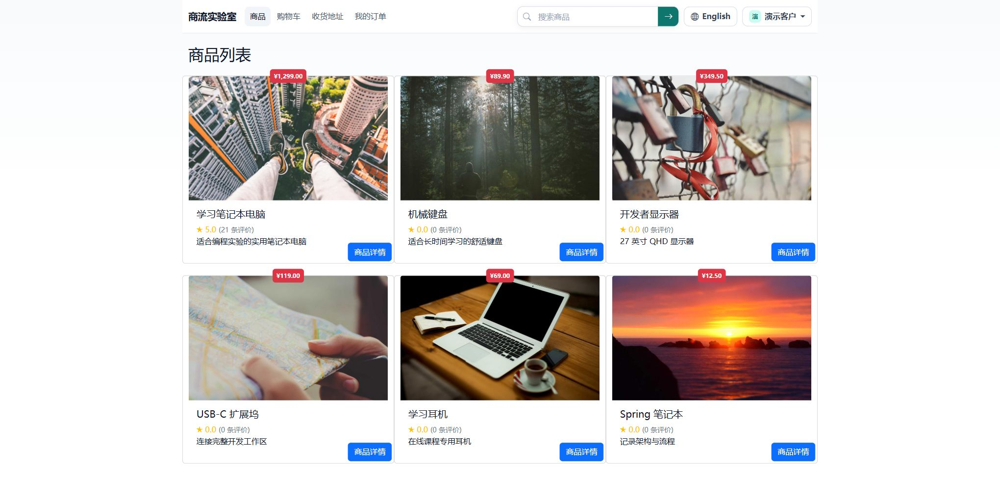
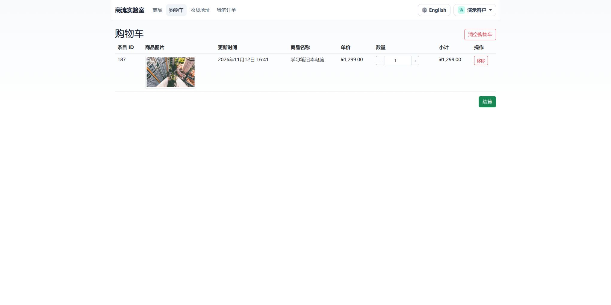
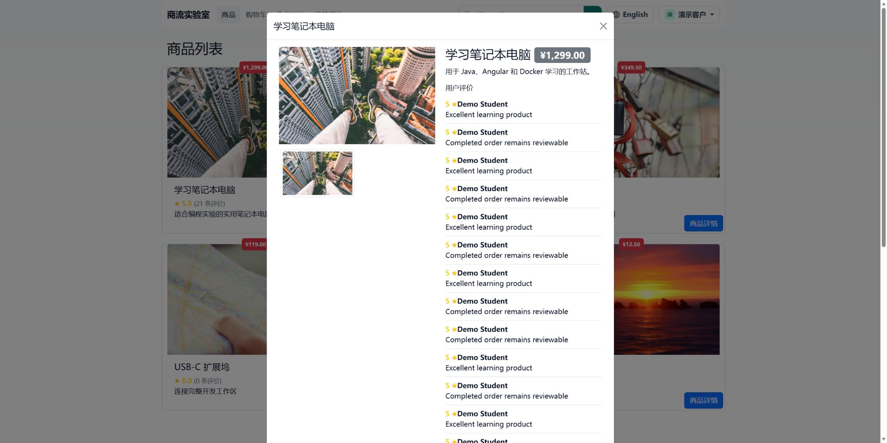
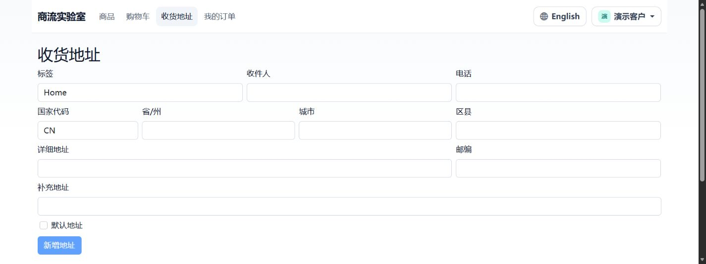
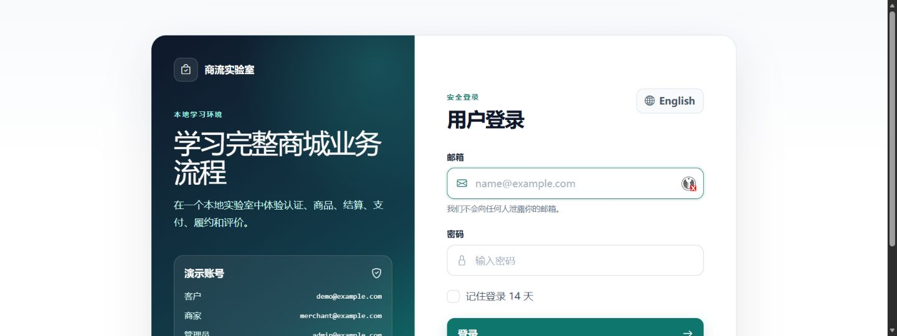
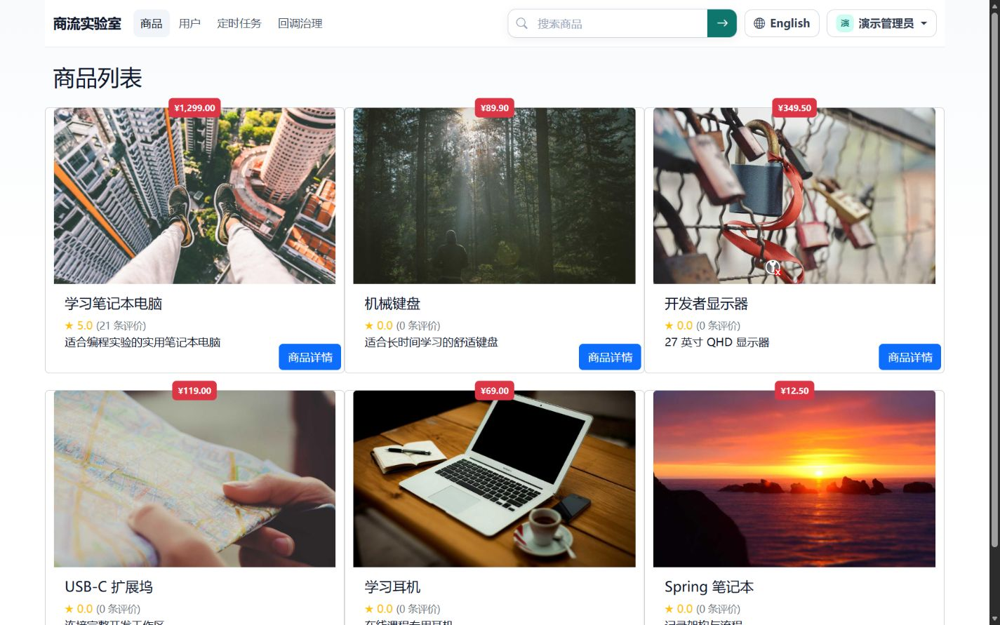
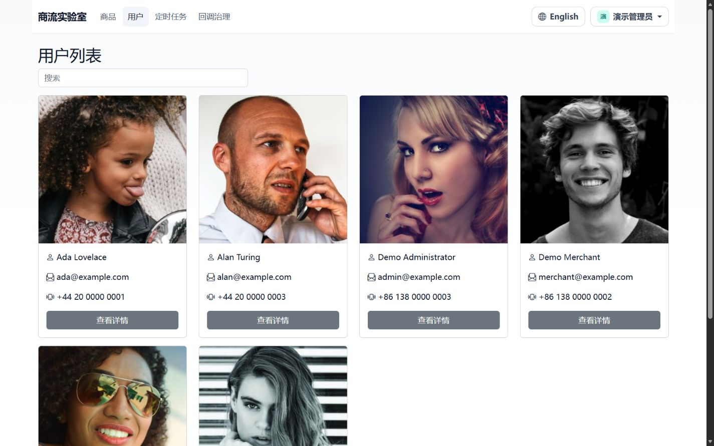
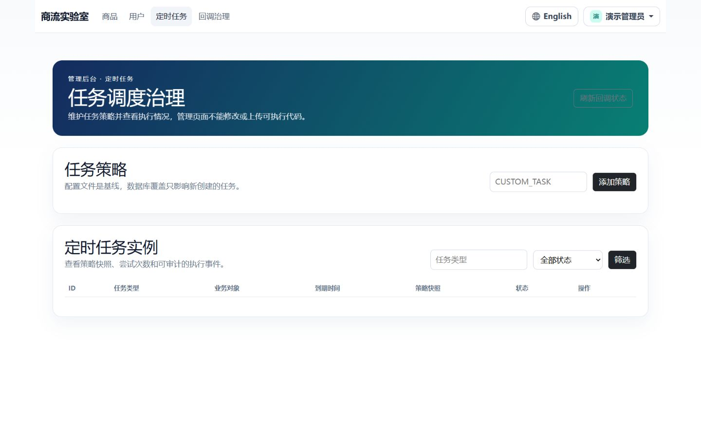
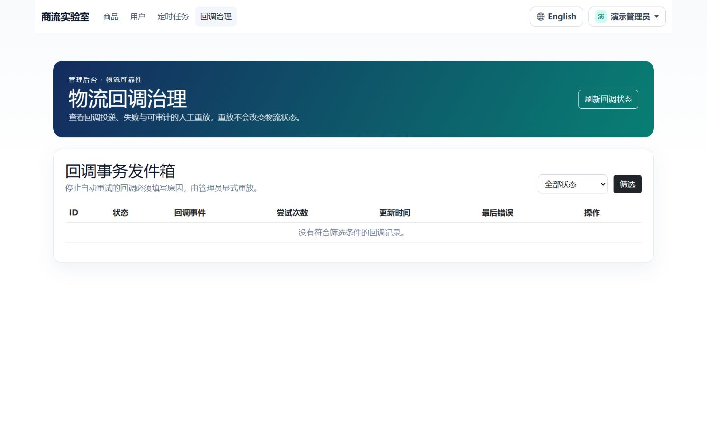
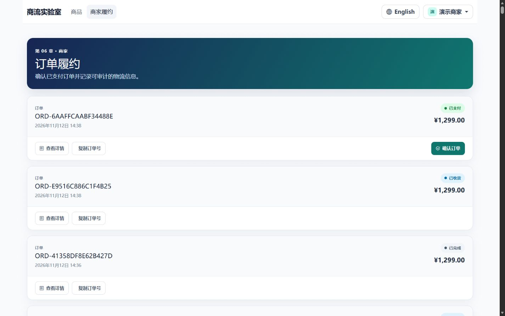

# Angular UI screenshots

截图来自本地 Docker Compose 环境中实际运行的 Angular 应用，使用 Edge 浏览器验证。截图按客户、管理员和商家角色分组。

## 客户角色

### 商品仪表板

### 购物车

### 商品详情

### 新增收货地址表单

### 登录页

## 管理员角色

### 商品仪表板

### 用户列表

### 定时任务治理

### 物流回调治理

## 商家角色

### 商品仪表板

### 订单履约

> 订单和已保存收货地址的页面可能包含本地运行数据中的姓名、电话和地址，因此不放入公开截图集。
